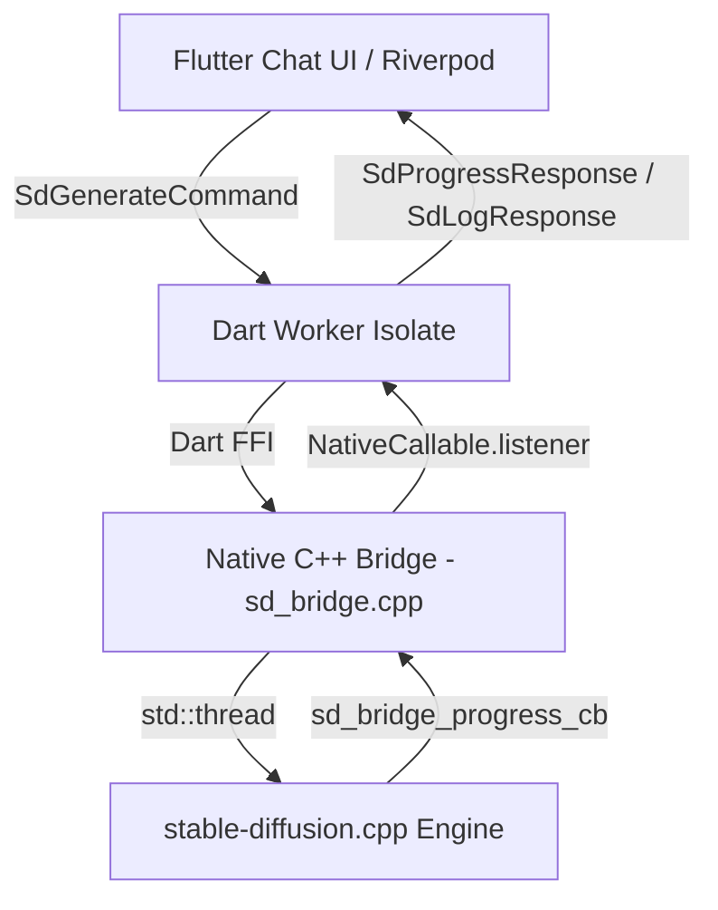

# Offline Image - 100% On-Device Stable Diffusion for Flutter

An offline Flutter application that generates high-fidelity images locally on mobile devices using **Stable Diffusion 2.1 GGUF (`stable-diffusion-v2-1-Q4_0.gguf`)** via high-performance C++ FFI bindings with **`stable-diffusion.cpp`**.

No cloud APIs, no telemetry, no internet required once the model is downloaded.

---

## ✨ Features

- **100% Offline AI Inference**: Generates images on-device using quantized GGUF models with no network connection.
- **Asynchronous C++ Native Threading**: Inference runs on an unmanaged C++ background `std::thread`, leaving Dart's isolate event loop 100% unblocked to deliver 60 FPS UI updates.
- **Real-Time Step-by-Step Progress & ETA**: Live tracking of denoising steps (e.g. `Step 14/20`), iterations per second, and dynamic remaining time estimation.
- **Interactive Pipeline Stage Stepper**:
  - `Loading Weights (mmap)`
  - `Prompt Text Conditioning (CLIP)`
  - `Denoising Latent Space (Euler / Euler Ancestral)`
  - `Tiled VAE Latent Decode`
  - `Exporting Image (PNG)`
- **Live In-App Python-Style Console**: Embedded collapsible terminal showing real-time native engine logs.
- **Instantaneous Abort & Stop Control**: Responsive cancel button that immediately sends `SD_CANCEL_ALL` to the C++ engine.
- **Robust Background Model Downloader**: Background resumable downloads with HTTP Range request support and crash recovery via `background_downloader`.
- **Hardware Wakelock Management**: Keeps the CPU and screen awake during inference and downloads via `wakelock_plus`.
- **Persistent Chat History**: Full multi-thread chat interface backed by a local SQLite database (`sqflite`).

---

## 🛠️ Architecture & Tech Stack



- **Framework**: Flutter 3.x (Dart 3.x)
- **State Management**: Riverpod (`flutter_riverpod`)
- **Native Inference**: `stable-diffusion.cpp` + `ggml` (built with CMake / Android NDK C++17)
- **FFI Integration**: `dart:ffi` with `NativeCallable.listener`
- **Database**: SQLite (`sqflite`)
- **File Downloader**: `background_downloader`
- **Hardware Keepalive**: `wakelock_plus`

---

## 🚀 Getting Started

### Prerequisites

1. **Flutter SDK**: 3.24+ ([Installation Guide](https://docs.flutter.dev/get-started/install))
2. **Android NDK**: Version `25.1.8937393` or later
3. **CMake**: 3.22.1+

### Installation

1. **Clone the repository**:
   ```bash
   git clone https://github.com/mohhhit/offline_image.git
   cd offline_image
   ```

2. **Install Flutter dependencies**:
   ```bash
   flutter pub get
   ```

3. **Run on a physical Android device**:
   ```bash
   flutter run --release
   ```
   *(Note: Physical device with at least 6 GB of RAM is recommended for running SD 2.1 inference).*

---

## 📦 Model Details

- **Model**: Stable Diffusion 2.1 (Q4_0 Quantized GGUF)
- **File Size**: ~2.18 GB
- **Default Resolution**: 512×512
- **Sampling Steps**: 20 steps
- **Guidance Scale (CFG)**: 7.0
- **VAE**: Tiled VAE decode enabled by default for mobile RAM safety.

The app automatically downloads the model on the first run with resumable chunking.

---

## 📄 License

This project is open-source under the [MIT License](LICENSE).
Inference engine powered by [stable-diffusion.cpp](https://github.com/leejet/stable-diffusion.cpp).
